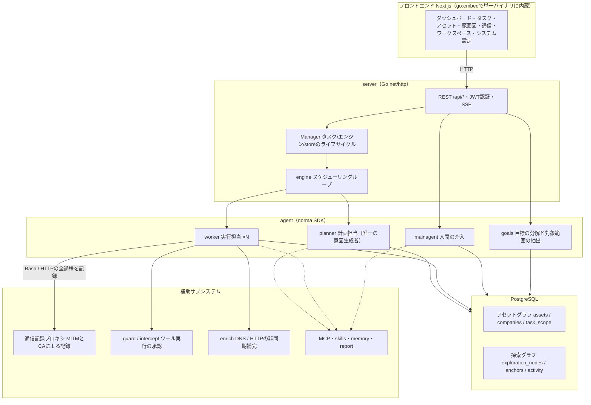
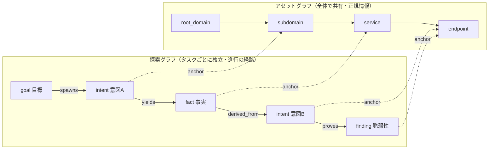
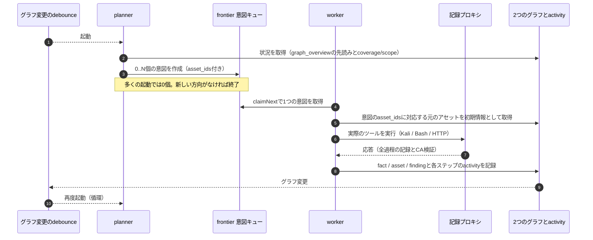
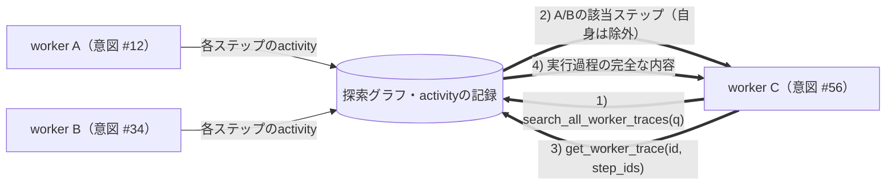
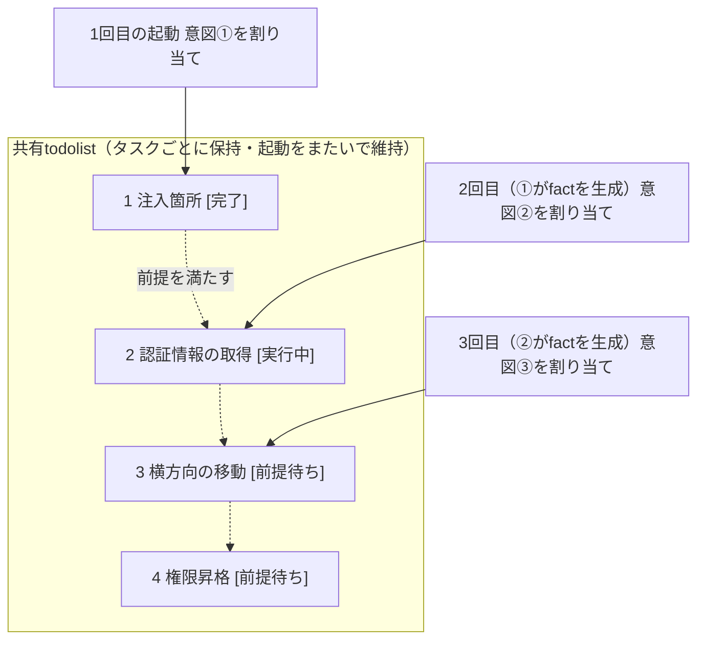

<div align="center">

# ARTEX

AIによる自律型ペネトレーションテストシステム（Goバックエンド + Next.jsフロントエンド）

🌐 **オンラインデモ**：[https://artex-demo.vercel.app/](https://artex-demo.vercel.app/)

</div>

---

## スクリーンショット

> 実際の操作は[オンラインデモ](https://artex-demo.vercel.app/)で確認できます。

| ダッシュボード（概要 / トークン消費 / アクティビティ） | タスク一覧 |
| :---: | :---: |
|  |  |

| タスクの実行過程（セッション / ツール呼び出し） | 探索経路 |
| :---: | :---: |
|  |  |

| 検出結果 | アセット |
| :---: | :---: |
|  |  |

| アセットのテスト範囲図（力指向レイアウト・テスト済みの強調表示・ノードの折りたたみと展開） |
| :---: |
|  |

| 通信の記録 | 人間が介入できる対話 |
| :---: | :---: |
|  |  |

| エージェント管理 | LLM設定 |
| :---: | :---: |
|  |  |

| 実行前の承認 | バックエンドログ |
| :---: | :---: |
|  |  |

---

## 承認履歴の詳細

全体の「承認履歴」、タスク内の「実行前の承認」、対話内の承認カードは、いずれも展開して詳細を確認できます。表示構成は
[AegisHookの承認詳細コンポーネント](https://github.com/RuoJi6/AegisHook/blob/main/web/src/components/CallDetail.vue)を参考にし、ARTEXのコンポーネントとテーマを使用しています。

## アセットの同期（ScopeSentry）

[ScopeSentry](https://github.com/Autumn-27/ScopeSentry)からアセット情報を直接同期できるため、再収集の手間を省けます。

- 「**アセット同期**」ページにScopeSentryのアドレスとAPIキーを入力して、データソースを接続します。
- **プロジェクト**または**タスク**単位で、同期する対象とアセットの種類（ドメイン / サブドメイン / IP / ポート / サイト / エンドポイントなど）を選択します。
- ワンクリックで取り込み、企業のアセット範囲ごとにまとめます。取り込んだ情報はARTEXのアセットグラフに入り、エージェントによる探索に利用できます。

---

## インストール

> データベースとして**PostgreSQL**が必要です。探索には**LLM**の設定が必要です（`ANTHROPIC_API_KEY`または`OPENAI_API_KEY`。UIからも設定できます）。

### 方法1：一括インストールスクリプト（推奨）

```bash
git clone https://github.com/Hinln/ARTEX.git
cd ARTEX
./install.sh
```

スクリプトはDockerを検出し、必要に応じて自動インストールした後、**①すべてDockerで実行**または**②ローカルでビルドして実行**を選択するよう案内します。

- **①すべてDocker**：Postgresのパスワードを入力（Enterでランダム生成）→ `.env`を自動作成 → `docker compose up -d`。
- **②ローカル実行**：データベースを選択（既存DBに接続 / DockerでDBを起動）→ `config.json`を生成 → `go`でフロントエンドを内蔵した単一バイナリをビルド → 起動。

インストール後、**[http://localhost:8787](http://localhost:8787)**を開きます（初回は`/setup`で管理者パスワードを設定）。

### 方法2：Docker Compose（手動）

```bash
git clone https://github.com/Hinln/ARTEX.git
cd ARTEX
cp .env.example .env          # POSTGRES_PASSWORDを設定。ANTHROPIC_API_KEYは任意
docker compose up -d          # autumn27/artexイメージとpostgresを取得
# → http://localhost:8787
```

イメージには一般的なツール（ripgrep/curl/vim/npm/nmapなど）が含まれます。`./skills`と`./data`はバインドマウントで永続化されます。

リモートMCPはシステム設定で`http`（Streamable HTTP）または`sse`（従来のSSE）を選択できます。
従来のSSEサービスでは通常、`GET /sse`でイベントストリームを確立し、サービスが返す
`/message?sessionId=...`でJSON-RPCリクエストを受信します。設定時はURLに`/sse`を指定し、リクエストヘッダーを
`Authorization=Bearer <token>`の形式で入力してください。

### 方法3：ビルド済みバイナリのダウンロード（Releases）

[Releases](https://github.com/Hinln/ARTEX/releases)から利用するプラットフォームのzipをダウンロードして展開すると、`artex`、`start.sh`（Windowsでは`start.bat`）、`skills/`、`config.example.json`が得られます。

```bash
cp config.example.json config.json   # databaseの接続情報を設定
./start.sh                           # → http://localhost:8787
```

> `./artex`を直接実行せず、`start.sh` / `start.bat`で起動してください。この監視スクリプトは、プログラム終了時の終了コードに応じて再起動します。**画面の[ワンクリック更新](#方法1画面からワンクリック更新推奨)も、このスクリプトによってバイナリを入れ替えます。** `./artex`を直接実行した場合、更新後に再起動されません。
> バックグラウンドで常駐させる場合：`nohup ./start.sh >artex.log 2>&1 &`。

### 方法4：ソースコードから単一バイナリをビルド

```bash
# 1) フロントエンドを静的エクスポート
cd web && npm ci && npm run build:static && cd ..
# 2) 埋め込み用ディレクトリにコピー
cp -r web/out server/webui/dist
# 3) ビルド（フロントエンドの埋め込みには-tags embeduiが必要）
CGO_ENABLED=0 go build -tags embedui -o artex ./cmd/artex
./start.sh
```

### 方法5：各プラットフォーム向けのReleaseアーカイブをビルド

`build.sh`はフロントエンドをビルドして埋め込み、Goのリンカーでデバッグ情報を削除した後、配布ファイルをzipに圧縮します。Releaseモードでは、標準でLinux amd64/arm64、macOS amd64/arm64、Windows amd64のzipを生成します。

```bash
./build.sh --release
# 出力：dist/artex-0.3.3-*.zip
```

UPXによる自己展開バイナリは、一部のLinuxカーネル、仮想化環境、セキュリティポリシーと互換性がない場合があるため、標準では無効です。`ARTEX_TARGETS`で対象を変更できます。実行環境の互換性を確認できた場合は、`--upx`を明示的に指定してバイナリをさらに小さくできます。

```bash
ARTEX_TARGETS=linux/amd64,windows/amd64 ./build.sh --release
./build.sh --target linux/amd64 --upx
```

---

## 更新・アップグレード

> 更新ではプログラムのみを入れ替え、データは変更しません。Postgresのデータボリューム`pgdata`、`./data`（jwt.key / SQLiteなど）、`./skills`は保持されます。**データベースの移行を手動で実行する必要はありません。** `artex`は起動のたびに`schema.sql`を冪等に実行します（`ADD COLUMN` / `CREATE INDEX IF NOT EXISTS`を含む）。つまり、再起動時に移行が行われます。更新前には`./data`とデータベースのバックアップを推奨します。

### このリポジトリの非公開Release更新元

画面からのワンクリック更新は、[Hinln/ARTEX Releases](https://github.com/Hinln/ARTEX/releases)を固定の更新元としてバージョンを確認し、ダウンロードします。ソースコードのクローンやGitによる更新も`Hinln/ARTEX`を使用します。元のプロジェクトのGo moduleパスは変更していません。

原文では、このリポジトリを非公開リポジトリとして説明しています。ARTEXのバックエンドプロセスに`ARTEX_UPDATE_GITHUB_TOKEN`を設定してください。トークンには、このリポジトリの**Contents: read**権限のみが必要です。バックエンドがReleaseの照会と添付ファイルの取得に使用し、ブラウザには送信しません。Gitにコミットしないでください。

```bash
# 現在のシェルまたはサービスの環境にARTEX_UPDATE_GITHUB_TOKENを安全に設定してから実行
./start.sh
```

ローカルで直接起動する場合、`start.sh`は`.env`を自動で読み込みません。変数をプロセスの環境にエクスポートする必要があります。Docker Composeでは、Git管理対象外の`.env`に変数を設定してartexコンテナを再作成できます。ただし、イメージにこのブランチの更新コードが含まれている必要があります。旧イメージでは、変数の設定だけで更新元は切り替わりません。

インストール可能な更新を画面に表示するには、更新元のリポジトリにdraftでもprereleaseでもない正式Releaseを公開し、`artex-<バージョン>-<os>-<arch>.zip`と`SHA256SUMS`を添付する必要があります。ソースコードしかない場合、オンライン更新は利用できません。既存のReleaseワークフローは、`v*`タグのpush時に、そのワークフローがあるリポジトリ用の添付ファイルを生成します。

### 方法1：画面からワンクリック更新（推奨）

**システム設定**ページ（サイドバー「システム設定」→ `/system/settings`）の**バージョンと更新**カードから、新しいバージョンを確認してインストールできます。サーバーへのログインは不要です。

「更新」を押すと、現在のプラットフォーム用の配布アーカイブを取得 → Releaseの`SHA256SUMS`と照合 → `-h`で新しいバイナリのスモークテスト → `artex.new`として一時保存 → プログラム終了 → `start.sh` / `start.bat`が再起動して入れ替え、という順に進みます。画面は新バージョンの起動を待って自動更新されます。

- **失敗したバイナリは適用されません**：検証やスモークテストに失敗した場合、一時ファイルを破棄して現行版を継続します。入れ替え後の新版が3回連続で起動に失敗した場合は、`artex.old`に自動で戻します（失敗したバイナリは調査用に`artex.failed`として保存）。
- **いつでも戻せます**：前のバージョンは`artex.old`として残り、カードに「前のバージョンへロールバック」が表示されます。ただし、データベース構造は戻りません。
- **更新により実行中のタスクは中断されます**。更新時には再起動するため、タスクが動いていないときに実施してください。
- **開発ビルドは更新対象外です**：バージョンが`dev`、または`git describe`の接尾辞付きの場合は無効になります。ローカルでデバッグ中のバイナリが正式版で上書きされることを防ぎます。
- **Docker環境ではプログラムだけを更新し、イメージは更新しません**：イメージ内のplaywright / nmapなどは更新されず、`docker compose up -d`でコンテナを再作成するとイメージに含まれるバージョンに戻ります。イメージも更新する場合は`docker compose pull artex && docker compose up -d artex`を実行してください。
- GitHubへの接続にプロキシが必要な場合、同じ画面で**グローバルプロキシ**を設定すると、更新にも使用されます。ダウンロード元はGitHubドメインに限定し、HTTPSを強制します。

### 方法2：一括更新スクリプト

```bash
cd ARTEX
./update.sh
```

必要に応じて`git pull`で最新コードを取得した後、**①Dockerで更新**または**②ローカルでビルドして更新**を選択します（`install.sh`に対応）。

- **①Docker**：イメージのtagを指定（Enterで`.env`の`ARTEX_TAG`を使用。未設定なら`latest`）→ `docker compose pull` → `docker compose up -d`。新しいイメージで再起動すると自動で移行します。
- **②ローカル**：フロントエンドの静的ファイルを再ビルド → `./artex`を再ビルド。完了後、プロセスを再起動して反映します。

### 方法3：Docker Compose（手動）

```bash
cd ARTEX
git pull                       # composeやスクリプトを更新（任意）
# バージョン指定：.envでARTEX_TAG=v0.2.0を設定。未設定ならlatest
docker compose pull artex
docker compose up -d artex     # 新しいイメージで再起動 → schemaを自動移行
docker image prune -f          # 古いイメージを削除（任意）
```

### 方法4：ビルド済みバイナリ（Releases）

[Releases](https://github.com/Hinln/ARTEX/releases)から新版のzipを取得し、旧プロセスを停止してから`artex`と`skills/`を上書きします（自分の`config.json`と`data/`は保持）。その後、再起動してください。

```bash
cp -r <展開先ディレクトリ>/skills ./ && cp <展開先ディレクトリ>/artex ./
./start.sh
```

### 方法5：ソースコードからビルド

```bash
git pull
cd web && npm ci && npm run build:static && cd ..
cp -r web/out server/webui/dist
CGO_ENABLED=0 go build -tags embedui -o artex ./cmd/artex
# ./start.shを再起動
```

---

## 設定

**データベース**（`config.json`で設定。`ARTEX_PG_DSN`環境変数で上書き可能）：

```json
{
  "database": {
    "host": "127.0.0.1", "port": 5432,
    "user": "artex", "password": "yourpass",
    "dbname": "artex", "sslmode": "disable"
  }
}
```

**LLM**：`export ANTHROPIC_API_KEY=sk-...`（または`OPENAI_API_KEY`）を設定するか、UIの「LLM設定」ページに入力します。
任意の設定：`ARTEX_LLM_PROVIDER` / `ARTEX_LLM_MODEL` / `ARTEX_LLM_BASE_URL` / `ARTEX_LLM_PROXY`。

**並列実行**：各タスクのworkerエージェント数を「システム設定」で指定します（標準は3）。

**よく使う起動オプション**：`./start.sh -addr :8787 -proxy :8788`（`-addr`はフロントエンドとAPI、`-proxy`は通信記録用プロキシ）。起動スクリプトは引数をそのまま`artex`に渡します。

### リバースプロキシでの公開（HTTPS / 443のみを開放）

フロントエンドとAPI/SSEは同じバックエンドポート（標準は`:8787`）で提供されます。リアルタイムのアクティビティは標準で**同一オリジン**を使用するため、**`NEXT_PUBLIC_SSE_BASE`の設定は不要**です。外部には443のみを開放し、8787は内部ネットワークに配置できます。

SSEは長時間接続して継続的にイベントを送るため、リバースプロキシの**バッファリングを無効にする必要があります**。有効な場合、ブラウザは接続できてもイベントを受信できず、アクティビティの読み込み表示が続きます。Nginxの設定例：

```nginx
server {
    listen 443 ssl;
    server_name your.domain.com;
    # ssl_certificate / ssl_certificate_key ...

    location / {
        proxy_pass http://127.0.0.1:8787;
        proxy_set_header Host $host;
        proxy_set_header X-Forwarded-Proto $scheme;

        # SSEの重要設定：バッファリング無効、長いタイムアウト、HTTP/1.1
        proxy_buffering off;
        proxy_cache off;
        proxy_read_timeout 3600s;
        proxy_http_version 1.1;
        proxy_set_header Connection "";
    }
}
```

> SSEをページと別のオリジン（独立したサブドメインなど）で提供する場合に限り、**ビルド時**に`NEXT_PUBLIC_SSE_BASE`を設定します。この値は`next build`時に静的ファイルへ埋め込まれるため、コンテナ起動時に設定しても反映されません。

---

## 開発

### 脆弱性の手動再テスト

タスク詳細の「再テスト」タブでは、タスク内の脆弱性をページ単位で選び、過去の結論や証拠を確認し、手動で再テストを開始できます。開始後も現在のタブを保持し、読み込みアイコンと「再テスト中」を表示します。修正を確認すると脆弱性の状態を更新します。

脆弱性一覧の各行で「再テスト」を押すか、脆弱性詳細の「脆弱性の再テスト」で「再テストを開始」を押し、必要に応じて修正バージョン、テスト条件、制約を入力します。システムは独立した再テスト用エージェントセッションを作成し、開始後も現在の画面を保持します。一覧のフラット表示、タスク別表示、アセット表示から利用できます。実行中は「再テスト中」と読み込みアイコンを表示し、必要に応じて該当セッションを開けます。終了後は「再テスト」に戻ります。元のスキャンタスクを再起動する必要はありません。結論は「引き続き再現可能」「修正済み」「確認できない」の3種類で、各回の結論、証拠、セッションへのリンクを脆弱性詳細に保存します。

新しいバックエンドは初回起動時に、編集可能な「脆弱性の再テスト」（`retester`）エージェントを作成します。エージェント管理でプロンプト、LLM、実行予算、ツールを設定できます。標準ではエージェントに紐付けたLLMを使い、未設定なら全体で有効な設定を使用します。再テストセッションが正常終了して結論が「修正済み」の場合、脆弱性の対応状態も自動で「修正済み」にします。実行中、失敗、停止、その他の結論では元の状態を保持します。元の証拠と報告書は常に保持します。状態のプルダウンから手動で「修正済み」を選択することもできます。同じ脆弱性が再テスト中なら既存のセッションを利用し、停止、失敗、サービス再起動後は再度開始できます。

このバージョンの履歴は脆弱性詳細とセッションから確認できます。脆弱性レポートのエクスポートやタスクのアーカイブにはまだ含まれず、通信記録との自動関連付けもありません。デモモードは模擬記録と明示したデータだけを生成し、実際の対象にはリクエストしません。

### ローカル実行とテスト

```bash
./dev.sh    # バックエンド(:8787) + 通信プロキシ(:8788) + Next.js開発サーバー(:5173) → http://localhost:5173
```

- バックエンド：`go run ./cmd/artex`（`-tags embedui`なしではフロントエンドを内蔵しません）
- フロントエンド：`cd web && npm run dev`（`/api`をバックエンドへ転送。ホットリロード対応）
- テスト：`go test ./...`
- モック表示（バックエンド不要）：`cd web && NEXT_PUBLIC_MOCK=1 npm run dev`

---

## システムの技術構成

ARTEXは、**LLMの複数エージェントで動く自律型ペネトレーションテストシステム**です。Goの単体バックエンド（Next.jsフロントエンドを内蔵）とPostgreSQLで構成され、エージェントの機能は[`norma`](https://github.com/Autumn-27/norma) SDK（`agentcore` / `tool` / `permission` / `harness` / `memory` / `transcript`）が提供します。中心となるのは**2種類のグラフによる構成**と、それを支える**worker間での実行過程の情報交換**、**plannerが複数回の実行で共有するtodolistによる攻撃経路の安定化**です。

### 全体の階層構成



| 階層 | 役割 |
| --- | --- |
| **フロントエンド** | Next.jsの静的エクスポートを`go:embed`で単一バイナリに内蔵。タスク、アセット、探索経路、範囲図の可視化と、人間が介入できる対話 |
| **server** | `net/http`によるルーティング、JWT認証、SSE。`Manager`がタスク、エンジン、DB storeのライフサイクルを管理 |
| **engine** | タスクごとに1つの`plannerLoop`とN個のworker goroutine。意図の取得、タイムアウト、一時停止、drain |
| **agent** | goals / planner / worker / mainagent。`ToolSet`が2つのグラフをLLM用ツールとして公開 |
| **db** | 2つのグラフをPostgresに保存（pgx）。`go:embed`で内蔵したschemaを起動ごとに冪等に適用 |
| **補助機能** | 記録用MITMプロキシ、承認、非同期補完、MCP / スキル / メモリ / レポート |

### 2つのグラフ：探索グラフとアセットグラフ

システムは「**対象は何か**」と「**どこまでテストしたか**」を、独立しつつアンカーで結び付く2つのグラフで管理します。

- **アセットグラフ（Asset Graph、全体で共有）**：タスクをまたいで共有するアセットの正規情報です。ノードは`root_domain / subdomain / ip / service / app / endpoint`で、企業に紐付きます。ドメイン→サブドメイン→サービス→エンドポイントの親子関係と重複排除キーはすべてプログラムで計算し、エージェントは元の情報のみを登録します。
- **探索グラフ（Exploration Graph、タスクごとに独立）**：各タスクの思考と進行を記録します。ノードは`goal（目標）/ intent（意図）/ fact（事実）/ finding（脆弱性）/ hint（ヒント）`で、`spawns / derived_from / yields / proves`などのエッジでつながります。「どの方向がどの事実から生まれ、何を得たか」を追跡できます。
- **アンカーによる接続**：`exploration_anchors(node_id, asset_id)`が意図、事実、脆弱性を具体的なアセットに結び付けます。探索方向から対象アセットを確認でき、アセットから、このタスクで実施した意図や得られた事実を逆引きできます。**アセットのテスト網羅率**と**アセットのテスト範囲図**（対象範囲のアセットとテスト済みの強調表示）も、この仕組みに基づきます。



> 役割分担：**planner**は探索グラフの状況と目標を確認し、未検証の新しい方向がある場合だけ**意図**をfrontierへ送ります。**worker**は**1つの意図**を受け取り、実際のツールで実行し、新しいアセット、事実、脆弱性を両グラフに記録して終了します。アセットグラフは共有の事実、探索グラフはタスクごとの進行経路です。

### エンジンと意図のライフサイクル（探索の循環）

エンジンは**イベント駆動**で動作します。グラフの変更でplannerを起動 → plannerが意図を作成 → workerが取得して実行し、結果を記録 → 記録が次の処理を起動、という循環を、目標が証明されるまで繰り返します（`prove_goal`）。



### worker間での実行過程の情報交換

深い探索では、エラー、応答の一部、隠れたパラメータなどの有用な観察がworkerの**実行過程**に現れても、正式なfactとして記録されない場合があります。作業の重複を防ぎ、他のworkerの成果を利用できるよう、workerには**別のworkerの実行過程を検索する機能**があります。

- `search_all_worker_traces(q)`：**同じタスク内の他のworkerの実行過程**をキーワード検索します。自身の意図に属するステップは自動で除外し、検索結果には`intent_id`を付けます。
- `list_worker_traces` / `get_worker_trace(intent_id, step_ids=[…])`：実行済みworkerの一覧を確認し、特定のworkerの指定ステップの内容を取得して詳細を共有します。

探索グラフに対応するfactがまだなくても、後続のworkerは他のworkerの観察を再利用できます。**情報は実行過程の単位でworker間を流れます**が、各workerは自分が受け取った1つの意図だけを担当します。



### plannerが複数回の実行で共有するtodolistによる攻撃経路の安定化

実際の攻撃経路は、注入箇所の発見 → 認証情報の取得 → 横方向の移動 → 権限昇格のように、前後の依存関係を持つ複数のステップで構成されます。すべてを同時に割り当てると順序が崩れるため、plannerは**タスクごとに保持し、起動をまたいで共有する計画用のtodolist**を持ちます。

- plannerはグラフが変更されるたびに起動するイベント駆動型ですが、**起動のたびに新しいセッションになります**。共有のtodolistに逐次的な利用経路を一度記録し、後続の実行で**依存関係に沿って意図を順に割り当てます**。1回の実行ですべてを先に展開することはありません。
- 各回では、前提のステップが完了し、依存するfactが存在する次のステップだけを割り当てます。進行に応じて一覧を更新し、factで満たされたステップを完了にします。



この仕組みにより、イベント駆動と状態を持たないセッションの組み合わせでも、攻撃経路を重複や順序の誤りなく安定して進められます。ARTEXが複数段階の利用経路を自律的に進めるための中心的な機能です。

---

## コミュニティ

QRコードを読み取ってWeChat公式アカウント**SecSentry**をフォローし、公式アカウント宛てにメッセージを送ると、交流グループに参加できます。

<div align="center">


</div>

---

## 参考

https://github.com/oritera/Cairn

## ライセンスと免責事項

### オープンソースライセンス

このプロジェクトは**GNU Affero General Public License v3.0（AGPL-3.0）**で公開されています。全文はリポジトリ直下の[LICENSE](LICENSE)を参照してください。

誰でも本プロジェクトを使用、変更、再配布できますが、**派生作品もAGPL-3.0でソースコードを公開する必要があります**。特に、**変更した本プロジェクトをネットワーク経由でユーザーに提供する場合（オンラインサービスとして公開する場合など）、そのユーザーに対応する完全なソースコードを公開する必要があります**。

> ⚠️ **重要**：オープンソースライセンス自体はソフトウェアの用途を制限しません。以下の「利用制限」と「免責事項」は、作者が利用者に対して示す追加の取り決めと声明です。遵守してください。

**ARTEXは個人の学習、ソースコード研究、ローカルでの技術検証のみを目的とし、オンラインのシステムやWebサイトに対する実際のテストには使用しないでください。**

### 許容される利用範囲

- **本プロジェクトのソースコードの閲覧、学習、研究**と、**ローカルの隔離環境**での技術原理の検証に限定します。
- 個人学習、学術研究、コードレビューなど、攻撃を目的としない用途を想定しています。

### 禁止事項

- **Webサイト、オンラインサービス、ネットワーク接続されたシステムへのスキャン、探査、脆弱性の利用、攻撃を厳禁とします**（許可の有無や、自分のアセットかどうかを問いません）。
- 実際のペネトレーションテスト、攻防演習、本番環境での利用を厳禁とします。
- 不正侵入、データ窃取、恐喝、サービス拒否攻撃、その他の破壊的・犯罪的活動への利用を厳禁とします。
- 利用する国・地域の法令に違反する行為への利用を厳禁とします。

### 法令遵守の責任

利用者は、利用する国・地域のサイバーセキュリティ、データ保護、コンピューター犯罪に関するすべての法令を遵守する必要があります。中国本土では「サイバーセキュリティ法」「データセキュリティ法」「個人情報保護法」および関連する司法解釈などが含まれます。**本ツールの利用によって生じるすべての法的責任と結果は、利用者自身が負います。**

### 免責事項

本プロジェクトは「現状のまま（AS IS）」提供され、明示または黙示の保証はありません。作者と貢献者は、利用方法の適否を問わず、本ツールの利用によって生じる直接・間接の損失、データ喪失、システム損傷、法的紛争について責任を負いません。**本プロジェクトのダウンロード、インストール、利用は、上記のすべての条件を読み、理解し、同意したことを意味します。**
